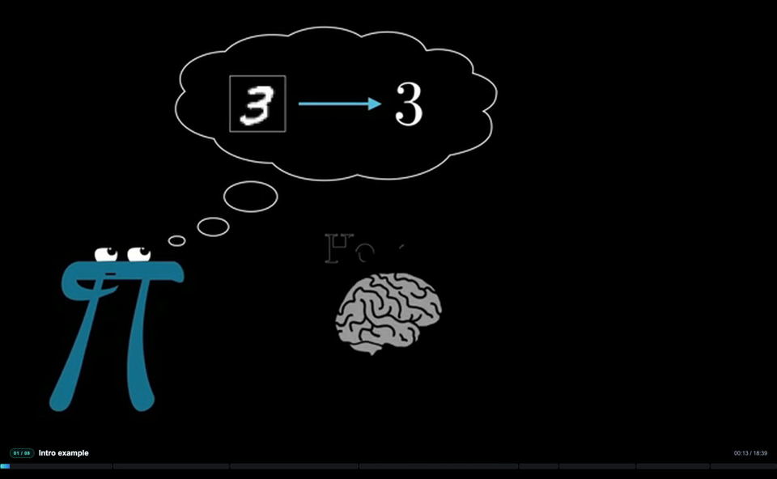
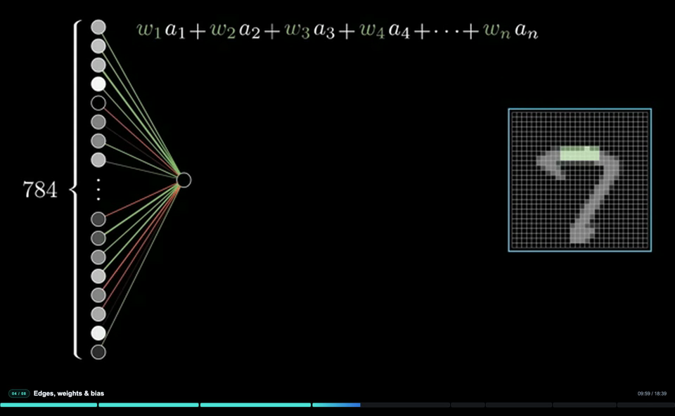

<p align="center">
  
</p>

<p align="center">
  <a href="LICENSE"></a>
  
  
  
</p>

<p align="center"><b>Turn a video into concise, topic-based chapters and a polished animated timeline MP4.</b></p>

## What Chaptr does

Give Chaptr a video link or local video and subtitle file. A coding agent analyzes the captions, finds meaningful topic changes, and renders a timeline beneath the video.

- **Semantic chapters:** analyze subtitle cues in context and group related ideas into a small set of useful sections.
- **Accurate timing:** chapter starts resolve to immutable subtitle cue IDs; media timestamps are calculated and validated by the pipeline.
- **Language-matched titles:** chapter titles follow the selected subtitle language. When captions contain multiple languages, the agent asks which language to use.
- **Designed timeline:** choose a restrained theme, show the active chapter and playback time, and keep the progress track aligned to the video edges.
- **Finished MP4:** combine the original video and audio with the rendered timeline, then verify duration, dimensions, and audio.
- **Chapter audit:** when source chapter timestamps are available, compare them with generated boundaries and summarize timing error and merged sections.

## Preview

<table>
  <tr>
    <td width="50%"><p align="center"><sub>Opening</sub></p></td>
    <td width="50%"><p align="center"><sub>Later chapter</sub></p></td>
  </tr>
</table>

<p align="center"><sub>Output generated from <a href="https://www.youtube.com/watch?v=aircAruvnKk">3Blue1Brown's neural network video</a>.</sub></p>

## Use with Codex

### Install the skill

```bash
npx skills add haokanjiang/chaptr --skill chaptr -g -a codex -y
```

This installs Chaptr as a global Codex skill. Start a new Codex task with a video URL:

```text
$chaptr https://www.youtube.com/watch?v=VIDEO_ID
```

For local files, ask Codex to use the video and subtitle file:

```text
$chaptr Use /path/to/video.mp4 and /path/to/video.srt
```

The skill guides the agent through subtitle review, chapter selection, timeline styling, rendering, compositing, and output verification. The agent may ask you to choose a title language when the selected captions are multilingual.

## Run the media pipeline manually

Chaptr separates deterministic media processing from semantic chapter analysis. Fetch a video with existing platform captions:

```bash
python3 skills/chaptr/scripts/chaptr.py fetch "VIDEO_URL" --job jobs/demo
```

Or prepare local media and an SRT file:

```bash
python3 skills/chaptr/scripts/chaptr.py prepare \
  --video /path/to/video.mp4 \
  --srt /path/to/video.srt \
  --job jobs/demo
```

Follow [the Chaptr skill](skills/chaptr/SKILL.md) to analyze the subtitle batches and write `jobs/demo/chapters.json`. Then render and verify:

```bash
python3 skills/chaptr/scripts/chaptr.py finalize --job jobs/demo
cd renderer && npm install && node render.mjs --job ../jobs/demo && cd ..
python3 skills/chaptr/scripts/chaptr.py compose --job jobs/demo
python3 skills/chaptr/scripts/chaptr.py verify --job jobs/demo
```

The verified result is `jobs/demo/chaptr.mp4`. The separate timeline render is `jobs/demo/timeline.mp4`.

## Design and chapter guidance

The built-in themes are `tech`, `travel`, `game`, and `minimal`. Customize the palette and motion in `jobs/demo/timeline-design.json`; see the [design contract](skills/chaptr/references/design.md).

For a 10–30 minute video, Chaptr aims for 6–8 chapters and merges adjacent subtopics that form one continuous explanation. Chapter titles stay short, match the subtitle language, and appear in a single active-title header above the proportional progress track.

## Requirements and limits

- Python 3.10+, yt-dlp, FFmpeg, and ffprobe
- Node.js 20+ and Chromium for Remotion rendering
- A coding agent that can read and write local files
- Existing platform captions for URL downloads; automatic speech recognition is not included

Chaptr re-encodes video to composite the timeline and preserves source audio when compatible. HDR retention is not guaranteed. Only download content you are authorized to save; Chaptr does not bypass DRM or access controls.

## License

[MIT](LICENSE)
